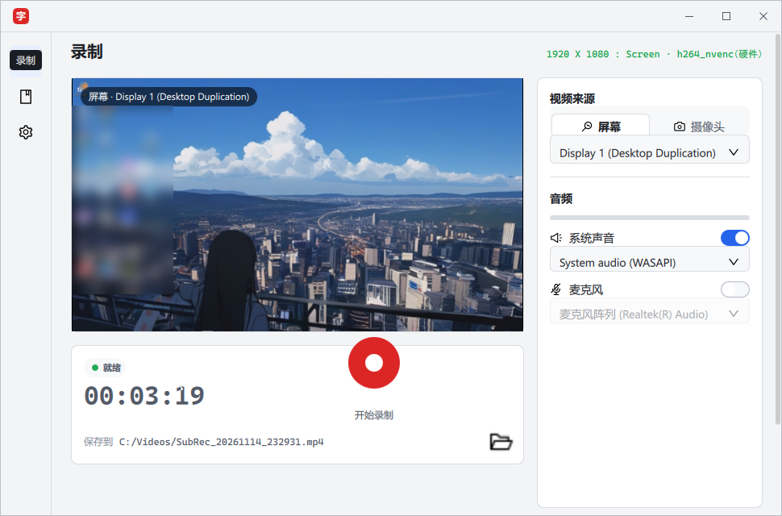
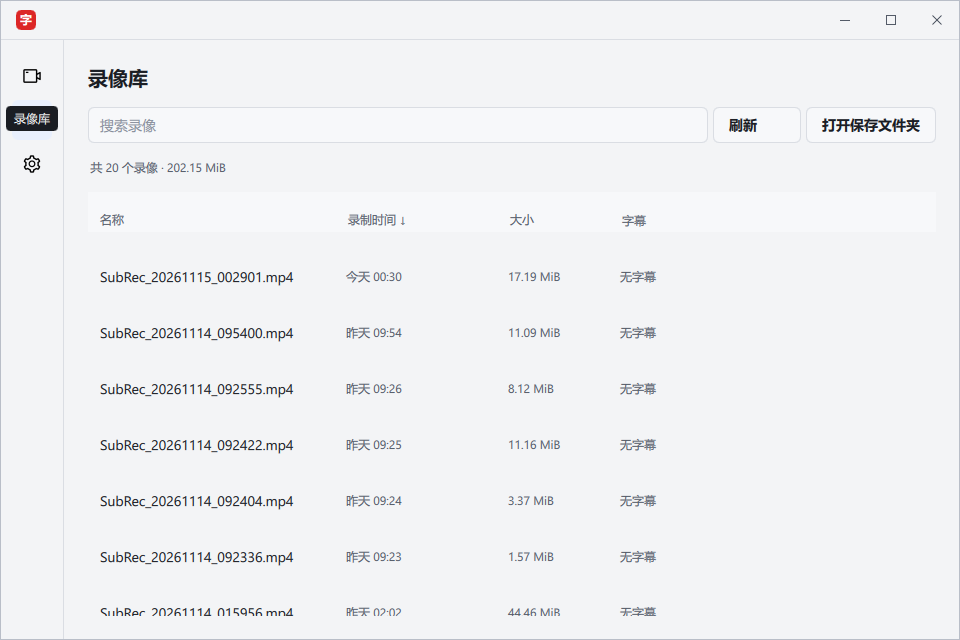
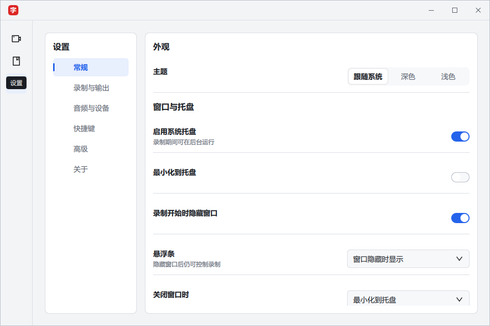
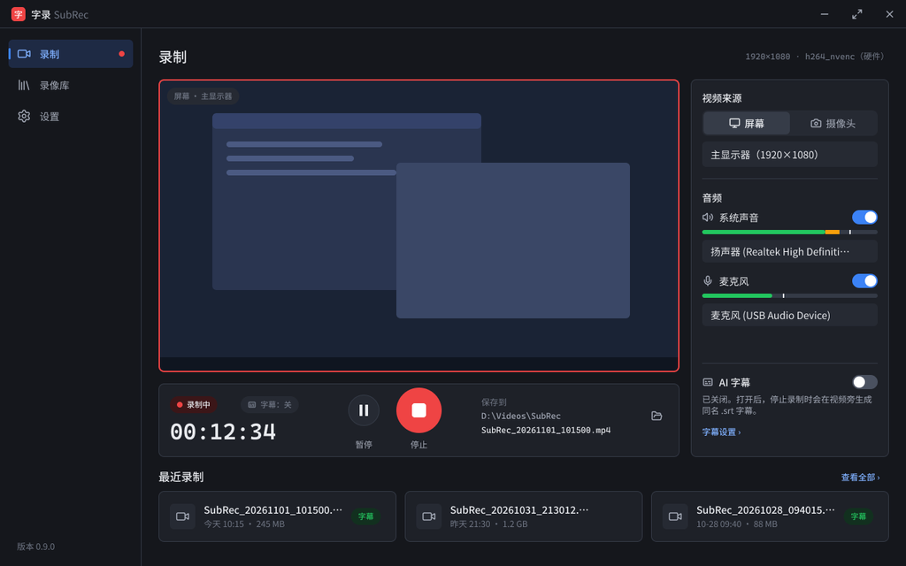
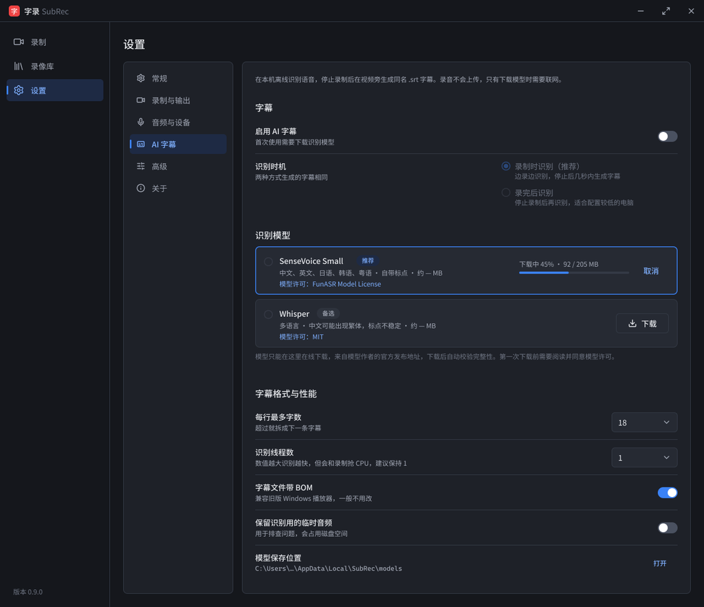

# 字录 · SubRec

**录屏即出片。**

## 字录是什么？

字录（SubRec）是一款面向 Windows 的开源录屏工具，基于 Qt 6 和 FFmpeg 开发，适合录教程、录会议、录游戏片段等日常场景。点一下开始，再点一下结束，得到的就是可以直接播放的 MP4 文件，不需要再导出或转码。

目前处于预发布测试阶段，仅支持 Windows。

本项目以 GNU General Public License v3.0 发布，详见 [LICENSE](LICENSE)。

## 截图



| 录像库 | 设置 |
|---|---|
|  |  |

> 以上为 Windows 上的实际运行截图（已隐去本机路径和桌面图标）。



> **设计预览**：录制中的界面效果图，来自 Figma 设计稿，并非实际运行截图。

## 功能

- 屏幕、摄像头、系统声音、麦克风采集，可在界面中切换视频源
- 系统声音与麦克风可单独开关，也可同时开启混音
- 录制暂停 / 继续
- 录制前和录制中的实时预览
- 停止即得 MP4 成片（H.264 视频 + AAC 音频）
- 自动选择硬件编码器（NVIDIA NVENC、AMD AMF、Intel QSV），没有可用硬件时使用 x264 软件编码
- 录像库：搜索、按名称 / 时间 / 大小排序，播放、在文件夹中显示、复制路径、删除到回收站
- 设置：浅色 / 深色主题、系统托盘与悬浮条、全局快捷键、保存位置与文件名模板、录制时从画面中排除本窗口

## 快速链接

- 下载（v0.3.2-beta）：<https://github.com/wocaonima335/SubRec/releases/tag/v0.3.2-beta>
- 全部版本：<https://github.com/wocaonima335/SubRec/releases>
- 源码仓库：<https://github.com/wocaonima335/SubRec>
- 问题反馈：<https://github.com/wocaonima335/SubRec/issues>

具体提供哪些文件（安装版 / 绿色版 zip、SHA256 校验文件）以 Release 页面为准。程序未做数字签名，请只从上面的 Release 页面下载。

## 从源码构建

需要 Windows、Qt 6.5 及以上、CMake、Ninja 和 MinGW 编译器，以及一份 FFmpeg 共享库（仓库不附带，可用 [`packaging/ffmpeg`](packaging/ffmpeg/README.md) 里的脚本自行编译）。

```powershell
# 先设置 QT_ROOT 和 SUBREC_FFMPEG_ROOT 环境变量
cmake --preset windows-mingw-release -DSUBREC_BUILD_NEW_UI=ON
cmake --build build/windows-mingw-release --target appSubRec
```

打包与发布流程见 [安装器说明](packaging/installer/README.md)。

## 路线图

下一阶段的重点是 **AI 字幕：边录边识别**。语音识别在本机离线运行，录制时就逐句生成字幕，录完立刻得到同名 `.srt` 文件；识别出问题不会影响录制本身。

- **M1 边录边出字幕**：录制时实时识别语音，界面上显示当前这句话；停止录制后几秒内生成完整字幕文件。
- **M2 更多模型、更准**：可在程序内下载和管理识别模型；录完后可选用更大的模型再精修一遍，并支持自定义热词。
- **M3 编辑与导出**：在录像库里查看、修改字幕，导出 VTT / ASS / TXT 等格式，预览画面上也能看到当前字幕。
- **M4 更多场景**：只识别麦克风的声音、给已有视频生成字幕、区分不同说话人。



> **设计预览**：AI 字幕设置页的效果图，功能尚在开发中，并非实际运行截图。

## 参与贡献

- 提交代码前请阅读 [CONTRIBUTING.md](CONTRIBUTING.md)，所有贡献需先签署 [CLA](CLA.md)。
- 行为准则：[CODE_OF_CONDUCT.md](CODE_OF_CONDUCT.md)
- 安全问题：[SECURITY.md](SECURITY.md)
- 第三方组件与许可：[THIRD_PARTY_LICENSES.md](THIRD_PARTY_LICENSES.md)

## 许可

字录以 [GPL-3.0](LICENSE) 发布。

## 友链

- [LINUX DO](https://linux.do)
